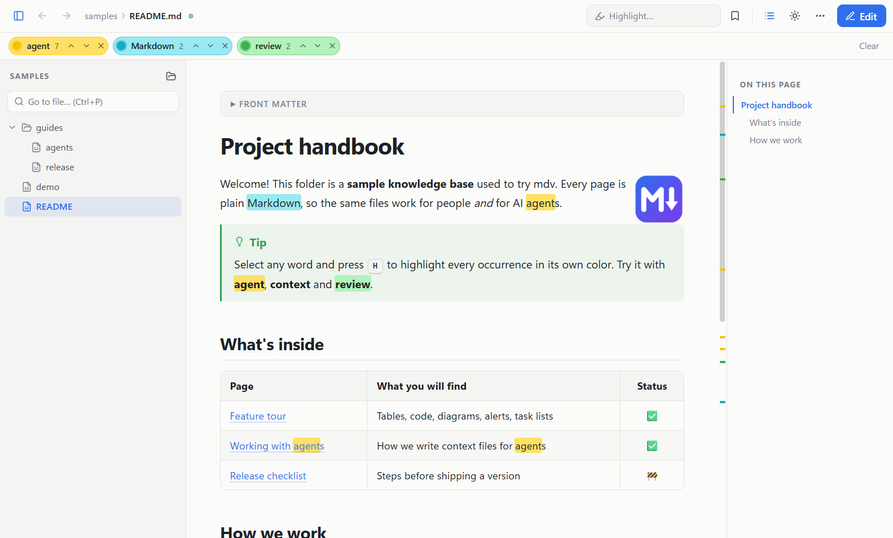
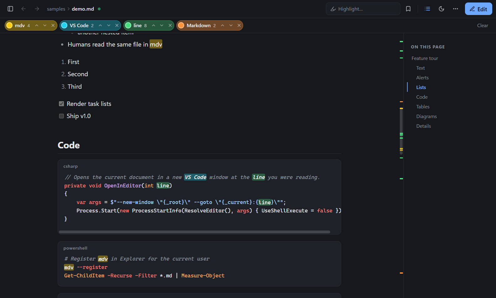

<div align="center">


# Marleo

Formerly **mdv**.

**A fast, clean Markdown viewer for Windows.**<br>
Open any `.md` file or folder straight from Explorer, read it distraction-free, highlight words in color like Notepad++,
and jump to VS Code — at the exact line you were reading — when you want to edit.

[](https://github.com/e-lifegood/marleo/actions/workflows/build.yml)
[](https://github.com/e-lifegood/marleo/releases/latest)
[](LICENSE)


[Install](#install) · [Features](#features) · [Shortcuts](#keyboard-shortcuts) · [Settings](#settings) · [How it works](docs/architecture.md) · [Contributing](CONTRIBUTING.md) · [Español](#en-español)



</div>

## Why

More and more of our documents are Markdown: specs, notes, prompts and context files for AI agents. Markdown is
plain text, diff-friendly and agent-ready — but on Windows, *reading* it comfortably is awkward. You either get raw
text (Notepad), an editor full of chrome (VS Code), or a note-taking app that wants to own your folders (Obsidian).

Marleo does one thing: **show Markdown beautifully, instantly, from wherever you are in Explorer** — and gets out of
the way when you want to edit.

The name says what it is for: *Marleo = **mark** (highlight) + **leo** (Spanish for "I read").*

| | Opens files *and* folders from Explorer | Clean reading view | Multi-color word highlighting | Jump to editor at the same line | Live reload |
| --- | :---: | :---: | :---: | :---: | :---: |
| **Marleo** | ✅ | ✅ | ✅ 10 colors, counts, navigation | ✅ | ✅ |
| PowerToys Peek | files only | ✅ | — | — | — |
| Windows Notepad (Markdown mode) | files only | basic | — | — | — |
| VS Code preview | via VS Code | side panel | editor only | ✅ | ✅ |
| Obsidian | as a "vault" | ✅ | with plugins | — | ✅ |

## Features

- **Explorer integration** — *Open with Marleo* on folders, folder backgrounds and `.md` files; make it the default app
  for `.md` so double-click opens it; type `marleo` in Explorer's address bar to open the current folder.
- **Clean, fast reading** — comfortable typography, light/dark themes (follows Windows), outline with scroll-spy,
  folder tree with quick filter (<kbd>Ctrl</kbd>+<kbd>P</kbd>), back/forward history, zoom, print to PDF.
  Remembers where you were in every file.
- **Highlight words in color** — like Notepad++ *Style all occurrences of token*, but better: 10 colors,
  live occurrence counts, next/previous per term (<kbd>Alt</kbd>+<kbd>1</kbd>…<kbd>9</kbd>), markers on the scrollbar,
  match-case / whole-word per term, and **saved highlight sets** you can load on any document.
- **Edit in VS Code** (<kbd>Ctrl</kbd>+<kbd>E</kbd>) — opens a new VS Code window with the folder as workspace, at the
  line you are reading. Works with VS Code Insiders, VSCodium, Cursor, or any editor you configure.
- **Live reload** — when you or an AI agent saves the file, the view updates instantly and keeps your scroll position
  (and follows the end of the file if you were at the bottom).
- **Rich Markdown** — GitHub-flavored tables, task lists, alerts (`> [!NOTE]`), syntax highlighting for ~40 languages,
  Mermaid diagrams, YAML front matter, local images and inline HTML (sanitized).
- **Small and private** — a native .NET + WebView2 app (~2 MB plus libraries), no telemetry, no network access, works
  offline. Your files are never modified.

<div align="center"></div>

## Install

**One line** (PowerShell, no admin rights):

```powershell
irm https://github.com/e-lifegood/marleo/releases/latest/download/install.ps1 | iex
```

It installs to `%LOCALAPPDATA%\Programs\marleo` and registers Marleo with Explorer. If the
[.NET 10 Desktop Runtime](https://dotnet.microsoft.com/download/dotnet/10.0) is present it downloads the small build,
otherwise the standalone one. Upgrading from **mdv** 0.1.0? Run the same line: it removes the old install and
Marleo brings over your settings, window position, view preferences and saved highlight sets.

**Manual:** download `marleo-win-x64.zip` (needs .NET 10 Desktop Runtime) or `marleo-win-x64-standalone.zip` from
[Releases](https://github.com/e-lifegood/marleo/releases), unzip anywhere and run `marleo.exe --register`.

**From source:** needs the [.NET 10 SDK](https://dotnet.microsoft.com/download) and [Node.js](https://nodejs.org).

```powershell
git clone https://github.com/e-lifegood/marleo.git
cd marleo
powershell -ExecutionPolicy Bypass -File install.ps1
```

**Requirements:** Windows 10 or 11 (x64) with the Microsoft Edge WebView2 Runtime (built into Windows 11).

### Make Marleo open `.md` files on double-click

Windows does not let apps make themselves the default, so do it once: right-click any `.md` file →
**Open with** → **Choose another app** → **Marleo** → **Always**. (If you had made mdv the default, do this once again
after upgrading.)

### Uninstall

```powershell
marleo --unregister
Remove-Item -Recurse "$env:LOCALAPPDATA\Programs\marleo"
```

## Usage

| From | Do this |
| --- | --- |
| Explorer, a file | Double-click a `.md` (after choosing Marleo as default) or right-click → *Open with Marleo* |
| Explorer, a folder | Right-click the folder (or inside it) → *Show more options* → *Open with Marleo* |
| Explorer address bar | Type `marleo` and press <kbd>Enter</kbd> — opens the folder you are in |
| Terminal | `marleo`, `marleo notes.md`, `marleo C:\docs` |
| The window itself | Drag & drop a file or folder onto it |

```text
marleo [file.md | folder] [--highlight "term1,term2"] [--theme light|dark]
marleo --register | --unregister
```

The old command name still works: `mdv` runs Marleo in terminals, Win+R and the Explorer address bar.

When you open a folder, Marleo shows its `README.md` (or `index.md`, or the first file) and a tree of every Markdown file
below it. Links between documents work — <kbd>Ctrl</kbd>+click opens them in a new window.

## Keyboard shortcuts

| Keys | Action |
| --- | --- |
| <kbd>Ctrl</kbd>+<kbd>E</kbd> | Edit in VS Code at the current line |
| <kbd>H</kbd> | Highlight the selected text (double-click a word, then <kbd>H</kbd>) |
| <kbd>Alt</kbd>+<kbd>1</kbd>…<kbd>9</kbd> / <kbd>Alt</kbd>+<kbd>Shift</kbd>+<kbd>1</kbd>…<kbd>9</kbd> | Next / previous occurrence of highlight 1–9 |
| <kbd>Ctrl</kbd>+<kbd>Shift</kbd>+<kbd>H</kbd> | Clear all highlights |
| <kbd>Ctrl</kbd>+<kbd>F</kbd>, <kbd>F3</kbd> | Find in document (pin the search as a highlight with one click) |
| <kbd>Ctrl</kbd>+<kbd>P</kbd> | Go to file |
| <kbd>Ctrl</kbd>+<kbd>B</kbd> / <kbd>Ctrl</kbd>+<kbd>T</kbd> | Toggle file tree / outline |
| <kbd>Alt</kbd>+<kbd>←</kbd> / <kbd>Alt</kbd>+<kbd>→</kbd> | Back / forward |
| <kbd>Ctrl</kbd>+<kbd>O</kbd> / <kbd>Ctrl</kbd>+<kbd>Shift</kbd>+<kbd>O</kbd> | Open file / folder |
| <kbd>Ctrl</kbd>+<kbd>D</kbd> | Theme: auto → light → dark |
| <kbd>Ctrl</kbd>+<kbd>+</kbd> / <kbd>-</kbd> / <kbd>0</kbd> | Zoom |
| <kbd>F5</kbd> | Reload |
| <kbd>Ctrl</kbd>+<kbd>Shift</kbd>+<kbd>C</kbd> | Copy file path |
| <kbd>Ctrl</kbd>+<kbd>,</kbd> | Open settings |
| <kbd>F1</kbd> | All shortcuts |

## Highlighting, in detail

1. Double-click a word (or select any text) and press <kbd>H</kbd> — or type it in the **Highlight…** box.
2. Every occurrence gets the term's color, a counter appears in the chip bar, and colored ticks mark them on the scrollbar.
3. Click the term (or press <kbd>Alt</kbd>+its number) to jump to the next occurrence; hover the chip for
   **Aa** (match case) and **ab** (whole word); click the dot to change color.
4. Save the current terms as a **set** with the bookmark button, and load the set on any other document later.

Highlights stay active as you move between documents in the same window. Accented and non-Latin text works.

## Settings

Press <kbd>Ctrl</kbd>+<kbd>,</kbd> to open `%APPDATA%\marleo\settings.json`:

```jsonc
{
  "editorPath": "",   // empty = auto-detect VS Code (also Insiders, VSCodium, Cursor)
  "editorArgs": "--new-window \"{folder}\" --goto \"{file}:{line}\"",
  "ignoredFolders": [".git", "node_modules", "bin", "obj", "dist", "..."],
  "markdownExtensions": [".md", ".markdown", ".mdown", ".mkd", ".mdx"]
}
```

Other editors: Notepad++ → `"editorPath": "C:\\Program Files\\Notepad++\\notepad++.exe", "editorArgs": "-n{line} \"{file}\""` ·
Sublime Text → `"editorArgs": "\"{file}:{line}\""` · same VS Code window → `"editorArgs": "--reuse-window --goto \"{file}:{line}\""`.

## How it works

Marleo is a small WinForms host (C#, .NET 10) around a WebView2 control. The host reads files, watches them, builds the
folder tree, talks to Explorer and launches your editor; the UI is plain HTML/CSS/JS rendering Markdown with
[markdown-it](https://github.com/markdown-it/markdown-it), [highlight.js](https://highlightjs.org) and
[Mermaid](https://mermaid.js.org), sanitized with [DOMPurify](https://github.com/cure53/DOMPurify). Everything is local.
Read the [architecture notes](docs/architecture.md) for the details.

## Contributing

Contributions are very welcome — bug reports, ideas, docs and code. Start with [CONTRIBUTING.md](CONTRIBUTING.md).
Good first areas: more languages for syntax highlighting, accent-insensitive highlighting, Windows 11 modern context
menu (sparse package), a "presentation" reading mode.

## License

[MIT](LICENSE) — free for personal and commercial use. Bundled libraries are listed in
[THIRD_PARTY_NOTICES.md](THIRD_PARTY_NOTICES.md).

---

## En español

**Marleo** (antes **mdv**) es un visor de Markdown para Windows: rápido, limpio y pensado para quienes trabajan con
archivos `.md` (documentación, notas, contexto para agentes de IA) en lugar de PDF o DOCX. El nombre viene de
**mar**car (resaltar) + **leo** (de leer).

- **Ábrelo desde el Explorador:** clic derecho en una carpeta → *Mostrar más opciones* → *Open with Marleo*; clic
  derecho en un `.md` → *Abrir con* → *Marleo* → *Siempre* (desde entonces, doble clic lo abre); o escribe `marleo` en
  la barra de direcciones del Explorador para abrir la carpeta actual. El comando `mdv` sigue funcionando.
- **Resaltado multicolor** al estilo de Notepad++: selecciona una palabra y pulsa <kbd>H</kbd>. Hasta 10 colores,
  contador de apariciones, saltar con <kbd>Alt</kbd>+<kbd>1</kbd>…<kbd>9</kbd>, marcas en la barra de desplazamiento y
  conjuntos de palabras guardados.
- **Editar en VS Code** con <kbd>Ctrl</kbd>+<kbd>E</kbd>: abre una ventana nueva de VS Code en la línea que estás leyendo.
- **Recarga automática:** si tú o un agente modifican el archivo, la vista se actualiza sola.
- Índice lateral, árbol de carpetas, tema claro/oscuro, diagramas Mermaid, tablas, alertas, resaltado de código.

**Instalar** (PowerShell, sin permisos de administrador):

```powershell
irm https://github.com/e-lifegood/marleo/releases/latest/download/install.ps1 | iex
```

Si ya tenías mdv 0.1.0, la misma línea lo reemplaza y Marleo conserva tu configuración, tus preferencias de
vista y tus conjuntos de resaltado.

Es software libre (licencia MIT): úsalo, modifícalo y comparte tus mejoras. ¡Las contribuciones son bienvenidas!
