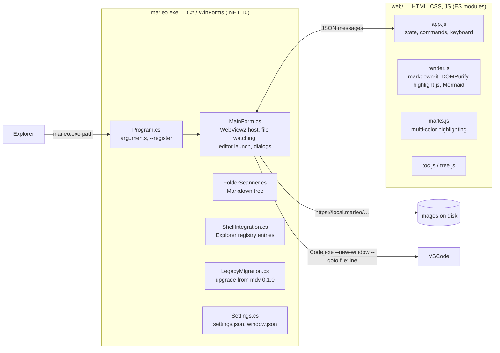

# Architecture

Marleo is two small pieces that talk through `postMessage`:



## Why WebView2 + a thin native host

- **Startup.** No Electron: the browser engine is the WebView2 runtime that ships with Windows 11, shared with Edge.
  The exe is ~200 KB of IL (ReadyToRun-compiled) plus the WebView2 interop DLLs.
- **Rendering quality.** Markdown, code and diagrams render with the same mature JS libraries GitHub-style tools use.
- **Native integration where it matters.** File watching, the Explorer registry, the editor launch and file dialogs
  are plain .NET.

## Startup path

1. `Program.Main` parses arguments (`LaunchOptions`).
2. `MainForm` reads `settings.json`, restores the window and reads the document *before* WebView2 exists, so the
   content is ready as soon as the page is.
3. WebView2 starts (shared profile in `%LOCALAPPDATA%\marleo\WebView2`: a second Marleo window reuses the browser process and
   opens much faster) and navigates to `https://app.marleo/index.html`, a virtual host mapped to the `web/` folder.
4. The page posts `ready`; the host answers with `init` and `doc`; the page renders and posts `rendered` (text visible)
   and then `settled` (Mermaid done). The folder tree is scanned on a background thread and sent afterwards.

Set `MARLEO_TRACE=1` (the old `MDV_TRACE=1` also works) to log the timing of each phase to
`%LOCALAPPDATA%\marleo\startup.log`. Typical numbers on a laptop:
~0.5 s to first render when another Marleo window is open, ~0.9 s fully cold (dominated by the WebView2 browser
process starting).

## Messages

Page → host (`chrome.webview.postMessage`):

| type | payload | effect |
| --- | --- | --- |
| `ready` | — | host sends `init`, the document and the tree |
| `open` | `path`, `hash?`, `newWindow?` | open a file or folder (tree clicks, history) |
| `link` | `href`, `newWindow?` | resolve a link relative to the current document |
| `external` | `url` | open in the default browser / app |
| `edit` | `line` | launch the editor at that line |
| `reload` | — | re-read the file and rescan the tree |
| `reveal`, `copy`, `openFileDialog`, `openFolderDialog`, `openSettings`, `close`, `devtools` | | as named |
| `theme` | `dark` | match the native title bar to the page theme |
| `drop` | + `File` objects | open what was dropped on the window |
| `rendered`, `settled` | — | startup timing, dev hooks |
| `jserror`, `log` | `message` | appended to `errors.log` / `marleo.log` in `%LOCALAPPDATA%\marleo` |
| `migrate` | `items` | only from `https://app.mdv/migrate.html`, during the one-time upgrade (see below) |

Host → page (`PostWebMessageAsJson`):

| type | payload |
| --- | --- |
| `init` | `version`, `theme?`, `highlights[]`, `settingsPath`, `folderMode`, `error?` |
| `doc` | `path`, `name`, `dir`, `root`, `content`, `reload`, `hash?` |
| `tree` | `root`, `tree` (`{name, path, dir, children}`), `truncated` |
| `missing`, `empty`, `toast`, `stats` | |

## Live reload

`FileSystemWatcher` watches the document's folder filtered to its file name, listening to *changed, created, deleted
and renamed* — so it also catches editors and agents that save by writing a temp file and renaming it over the
original. Events are debounced (150 ms), the file is read with `FileShare.ReadWrite | Delete` and a short retry if it
is locked, and the page re-renders only when the text actually changed. The page keeps the scroll position, or sticks
to the bottom if you were there (handy when an agent is appending).

A second watcher on the folder (subdirectories included) refreshes the sidebar tree when Markdown files or folders
appear, disappear or are renamed. Very large trees (over 20 000 entries) are truncated and not watched.

## Rendering pipeline (`web/js/render.js`)

1. Strip YAML front matter (shown as a collapsible block) and remember how many lines it took.
2. `markdown-it` with `html: true` and `linkify`, plus small core rules: `data-line` on every block (offset by the front
   matter), GitHub-style heading ids, task lists, GitHub alerts, code fences with highlight.js, Mermaid placeholders,
   tables wrapped for horizontal scrolling.
3. `DOMPurify` sanitizes the HTML (scripts, event handlers, iframes and `<style>` are removed).
4. Relative `img`/`video`/`audio` sources are rewritten to `https://local.marleo/<absolute path>`.
5. Highlights are re-applied, the outline rebuilt, and Mermaid runs if the document has diagrams (its 5 MB script is
   loaded only then).

## Highlighting (`web/js/marks.js`)

Each term becomes a Unicode-aware regular expression (optionally case-sensitive and/or whole-word using
`\p{L}\p{N}` boundaries). A `TreeWalker` visits text nodes of the rendered document, skipping SVG, Mermaid, existing
marks and UI chrome, and wraps matches in `<mark class="hl hl-N">`. Earlier terms win on overlap. The find bar uses
the same engine with its own class and may nest inside term marks. The overview ruler draws one tick per occurrence,
de-duplicated per pixel row.

## Security model

- The page can only navigate inside `https://app.marleo/`; every other navigation is cancelled and http(s)/mailto links
  open in the default browser.
- Documents are sanitized; the page has a strict Content-Security-Policy (`script-src 'self'`).
- `https://local.marleo/` serves **only media types** (images, audio, video) from disk, so a document can show its images
  but cannot read other files.
- Marleo never writes to your documents. It writes only `%APPDATA%\marleo\settings.json` and files under
  `%LOCALAPPDATA%\marleo`.

## Explorer integration (`ShellIntegration.cs`)

All keys live under `HKCU` (no admin rights):

| Key | Purpose |
| --- | --- |
| `Software\Classes\marleo.md` | ProgID used by "Open with" and default-app selection |
| `Software\Classes\.md\OpenWithProgids`, `.markdown\…` | list Marleo for Markdown files |
| `Software\Classes\SystemFileAssociations\.md\shell\marleo` | "Open with Marleo" verb on `.md` files |
| `Software\Classes\Applications\marleo.exe` | friendly name and supported types |
| `Software\Classes\Directory\shell\marleo`, `Directory\Background\shell\marleo`, `Drive\shell\marleo` | folder context menus |
| `Software\Marleo\Capabilities` + `Software\RegisteredApplications` | entry in Settings › Default apps |
| `Software\Microsoft\Windows\CurrentVersion\App Paths\marleo.exe` | `marleo` in the Explorer address bar and Win+R |
| `Software\Microsoft\Windows\CurrentVersion\App Paths\mdv.exe` | alias: `mdv` (the name up to 0.1.0) runs `marleo.exe` |
| `Environment\Path` | `marleo` in terminals (`mdv` too, via the `mdv.cmd` shim next to the exe) |

On Windows 11 the classic verbs appear under **Show more options**. Showing them in the compact menu requires an
`IExplorerCommand` handler in a signed sparse package — a good future contribution.

## Upgrading from mdv 0.1.0 (`LegacyMigration.cs`)

Up to 0.1.0 the app was called **mdv**. On `--register` and on the first start of Marleo (a marker file
`%LOCALAPPDATA%\marleo\migrated-from-mdv` makes later starts skip it), every step only fills in what is missing:

1. `%APPDATA%\mdv\settings.json` and `%LOCALAPPDATA%\mdv\window.json` are copied if Marleo has none yet.
2. The UI's localStorage (theme, zoom, outline, sidebar width, reading positions, saved highlight sets) belongs to the
   old origin `https://app.mdv`. If Marleo's WebView2 profile does not exist yet, the old profile's `Local Storage`
   folder is copied into it. The first window then maps `app.mdv` to `web/` for a moment, loads `migrate.html`
   (which posts every `mdv.*` key to the host), and registers a document-created script that writes them as
   `marleo.*` on `https://app.marleo` before the UI's scripts run, plus a `marleo.migrated` flag. If the page does not
   answer within 3 s the UI starts with its defaults. The outcome is logged to `%LOCALAPPDATA%\marleo\migration.log`.
3. The Explorer entries written by 0.1.0 (ProgID `mdv.md` and its `OpenWithProgids` values, the `shell\mdv` verbs,
   `Applications\mdv.exe`, `Software\mdv` and its `RegisteredApplications` value, the App Paths entry while it still
   points to the old `mdv.exe`, the old folder on PATH) are removed. `--register` always does this; a plain start does
   it only if Marleo is registered, so a portable or development copy never removes a working integration without
   replacing it. `--unregister` removes both the new and the legacy entries.

The old data folders are left in place; delete `%APPDATA%\mdv` and `%LOCALAPPDATA%\mdv` by hand once you are happy.

## Project layout

```text
src/Marleo/         native host (C#)
web/                UI: index.html, app.css, js/*.js, migrate.html (0.1.0 upgrade), vendor/ (generated)
scripts/            vendor.mjs (copies libraries), make-icon.ps1, get-marleo.ps1 (release installer)
tests/              run-tests.ps1 + scripts that drive the real app
samples/            documents used for manual checks, tests and screenshots
docs/               this file and README images
```
