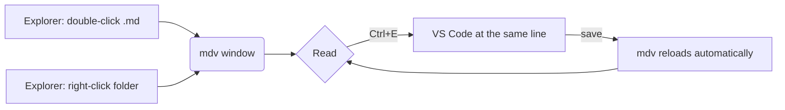
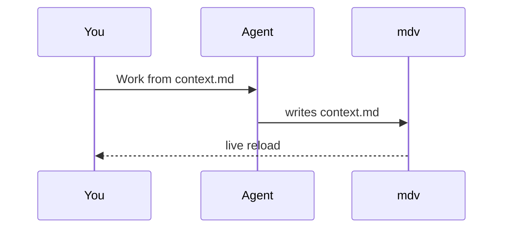

# Feature tour

This page exercises everything mdv renders. Use the outline on the right (<kbd>Ctrl</kbd>+<kbd>T</kbd>) to jump around.

## Text

Paragraphs with **bold**, *italic*, ~~strikethrough~~, `inline code`, [a relative link](guides/agents.md),
[an anchor in this page](#diagrams) and an autolinked URL: https://commonmark.org.
Accented words work with highlighting too: canción, configuración, información.

> A plain blockquote. It can span several lines and contain *formatting*.

## Alerts

> [!NOTE]
> Useful information that readers should know, even when skimming.

> [!IMPORTANT]
> Key information readers need to achieve their goal.

> [!WARNING]
> Urgent info that needs immediate attention to avoid problems.

> [!CAUTION]
> Advises about risks or negative outcomes of certain actions.

## Lists

- Agents read context from Markdown
  - nested item
  - another nested item
- Humans read the same file in mdv

1. First
2. Second
3. Third

- [x] Render task lists
- [ ] Ship v1.0

## Code

```csharp
// Opens the current document in a new VS Code window at the line you were reading.
private void OpenInEditor(int line)
{
    var args = $"--new-window \"{_root}\" --goto \"{_current}:{line}\"";
    Process.Start(new ProcessStartInfo(ResolveEditor(), args) { UseShellExecute = false });
}
```

```powershell
# Register mdv in Explorer for the current user
mdv --register
Get-ChildItem -Recurse -Filter *.md | Measure-Object
```

```json
{ "editorPath": "", "editorArgs": "--new-window \"{folder}\" --goto \"{file}:{line}\"" }
```

## Tables

| Shortcut | Action | Notes |
| --- | --- | --- |
| <kbd>H</kbd> | Highlight selection | Up to 10 colors, each with its own counter |
| <kbd>Alt</kbd>+<kbd>1</kbd>…<kbd>9</kbd> | Next occurrence of highlight *n* | <kbd>Shift</kbd> goes backwards |
| <kbd>Ctrl</kbd>+<kbd>E</kbd> | Edit in VS Code | Opens at the line you are reading |
| <kbd>Ctrl</kbd>+<kbd>F</kbd> | Find | Pin a search as a permanent highlight |

## Diagrams





## Images


## Details

<details>
<summary>Click to expand</summary>

Hidden content, rendered as Markdown too — including `code` and **bold**.

</details>

---

Back to the [handbook](README.md).
